# SportsWear · Tienda deportiva full stack

**Del catálogo al carrito, con un panel para gestionar cada producto.**

Proyecto integrador desarrollado por **Fabricio Quiroga y Marcelo Terrone**. Reúne una tienda responsive, una API REST y un dashboard de administración en una sola aplicación con **Node.js, Express, EJS y MySQL**.


[Funcionalidades](#funcionalidades) · [Capturas completas](#capturas-completas) · [Instalación](#instalación) · [API](#api-rest) · [Pruebas](#pruebas-automatizadas) · [Autores](#autores)

> **Demo académica, no tienda comercial.** El acceso por nombre solo personaliza la visita; no hay autenticación. La compra es una simulación sin pagos ni pedidos persistentes. El panel y la API de escritura no deben exponerse públicamente sin agregar autenticación y autorización.

## Vista de la tienda

Captura real de **página completa**, con catálogo, búsqueda, filtros y carrito. Las imágenes de demostración se sirven desde el propio proyecto.

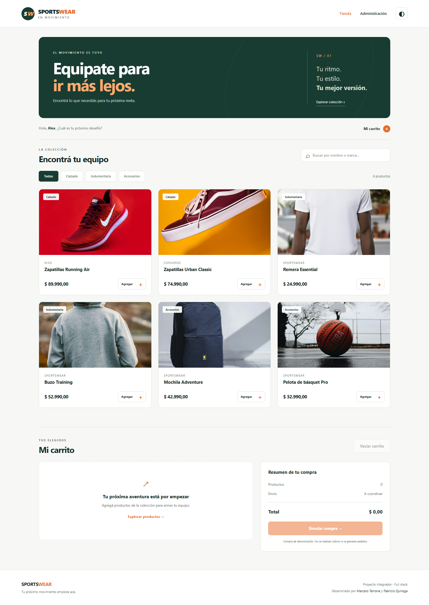

## Funcionalidades

### Experiencia de compra

- Inicio personalizado por nombre y navegación entre tienda y administración.
- Catálogo conectado a MySQL, con calzado, indumentaria y accesorios.
- Búsqueda por nombre o marca, combinable con el filtro de categoría.
- Carrito con cantidades, subtotales, total en pesos argentinos y eliminación de productos.
- Persistencia local del carrito y del modo claro/oscuro.
- Al restaurar el carrito, los precios se consultan nuevamente a la API y se descartan productos inactivos o eliminados.
- Estados de carga, catálogo vacío, búsqueda sin resultados y reintento ante un error de conexión.
- Diseño adaptable a escritorio y móvil, con etiquetas accesibles y navegación por teclado.

### Administración y backend

- Dashboard con indicadores y listado de productos activos e inactivos.
- Alta, consulta por ID, edición con campos precargados y eliminación con confirmación.
- Activación y desactivación de productos sin borrarlos del catálogo administrativo.
- API REST con validación de ID, precio, categoría, estado e imagen.
- Consultas SQL parametrizadas y manejo de errores sin exponer credenciales.
- Esquema SQL, datos de demostración y preparación de base de datos mediante un comando.

## Capturas completas

Las **11 capturas** se generaron con Chromium y Playwright usando datos de demostración en una base MySQL aislada. Son capturas `fullPage`, no recortes ni maquetas. Hacé clic en una imagen para verla en su resolución original.

<details>
<summary><strong>01 · Inicio y acceso por nombre</strong></summary>

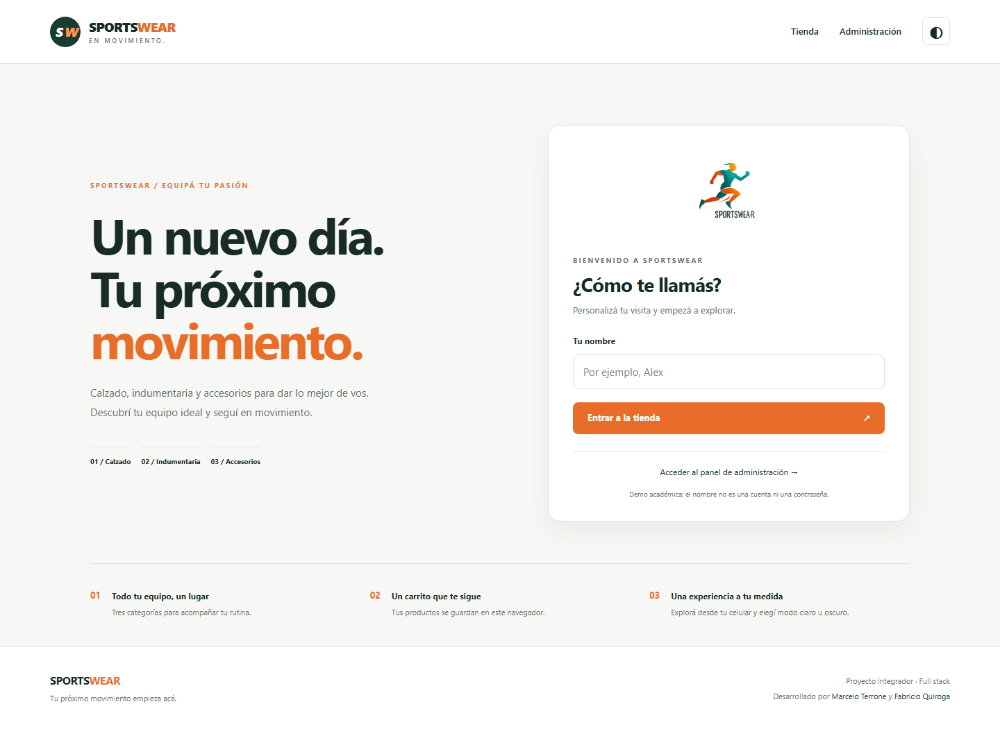

</details>

<details>
<summary><strong>02 · Tienda y catálogo completo</strong></summary>


</details>

<details>
<summary><strong>03 · Carrito con productos, cantidades y resumen</strong></summary>

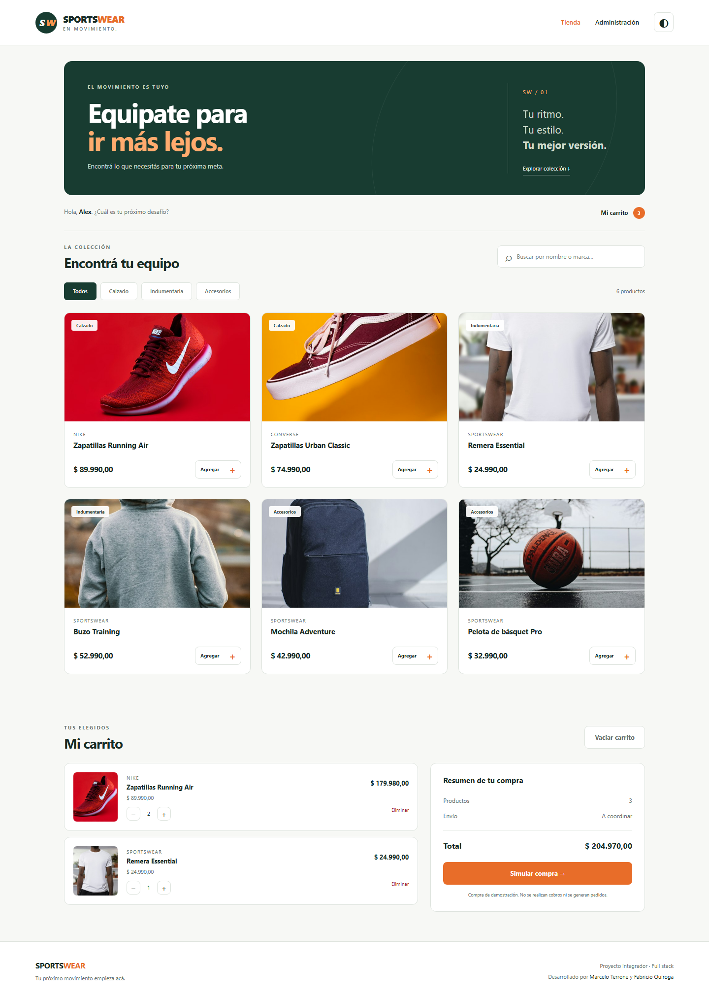

</details>

<details>
<summary><strong>04 · Modo oscuro</strong></summary>

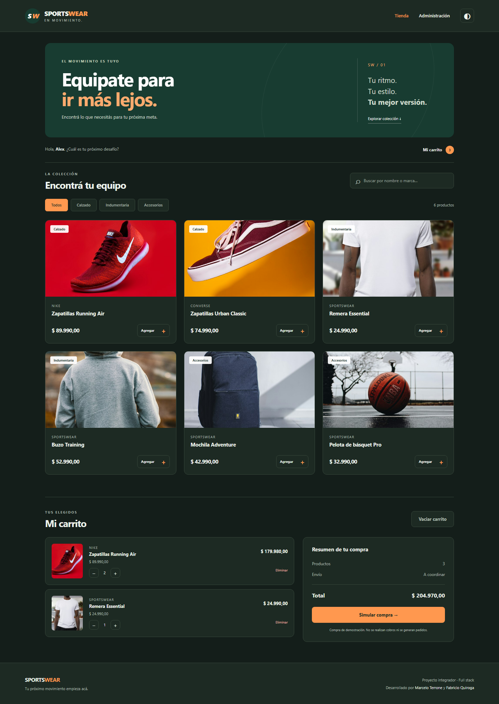

</details>

<details>
<summary><strong>05 · Dashboard de administración</strong></summary>

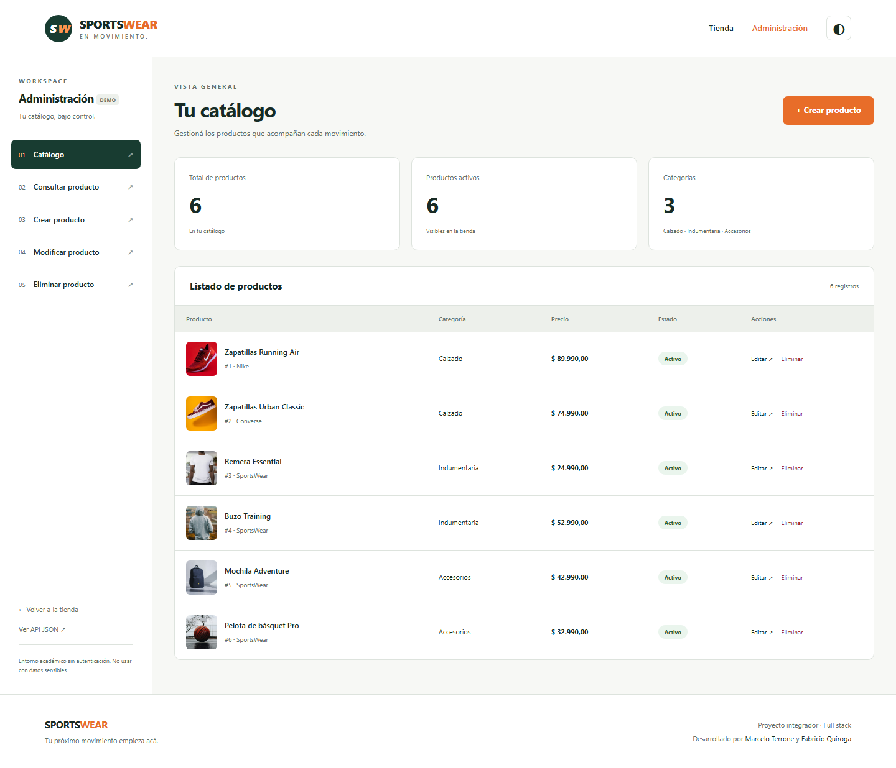

</details>

<details>
<summary><strong>06 · Consulta por ID</strong></summary>

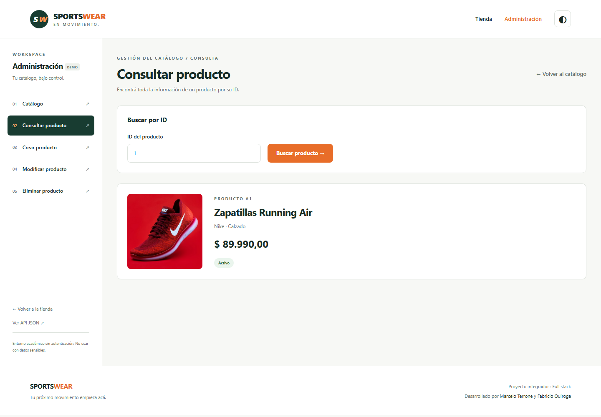

</details>

<details>
<summary><strong>07 · Creación de productos</strong></summary>

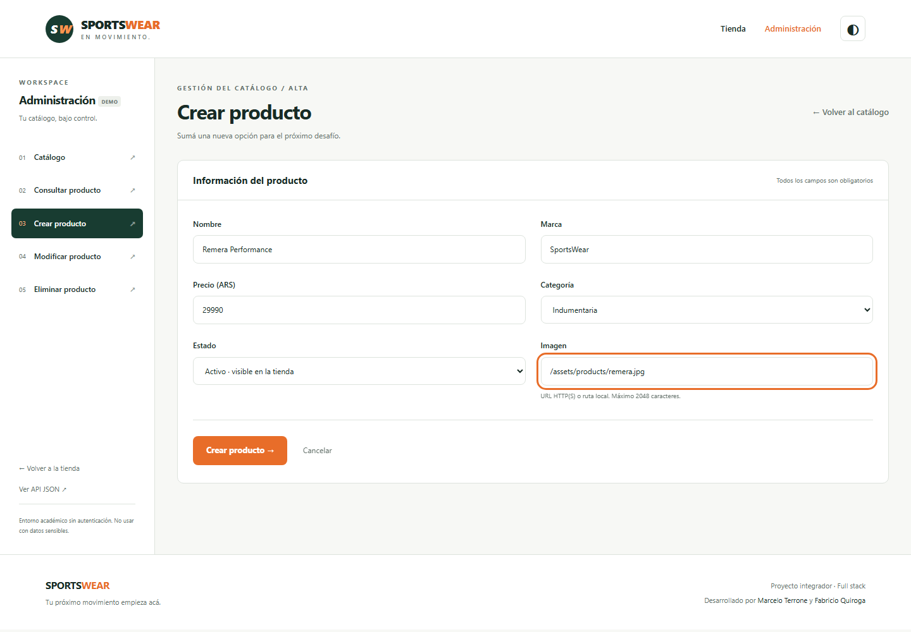

</details>

<details>
<summary><strong>08 · Edición con datos precargados</strong></summary>

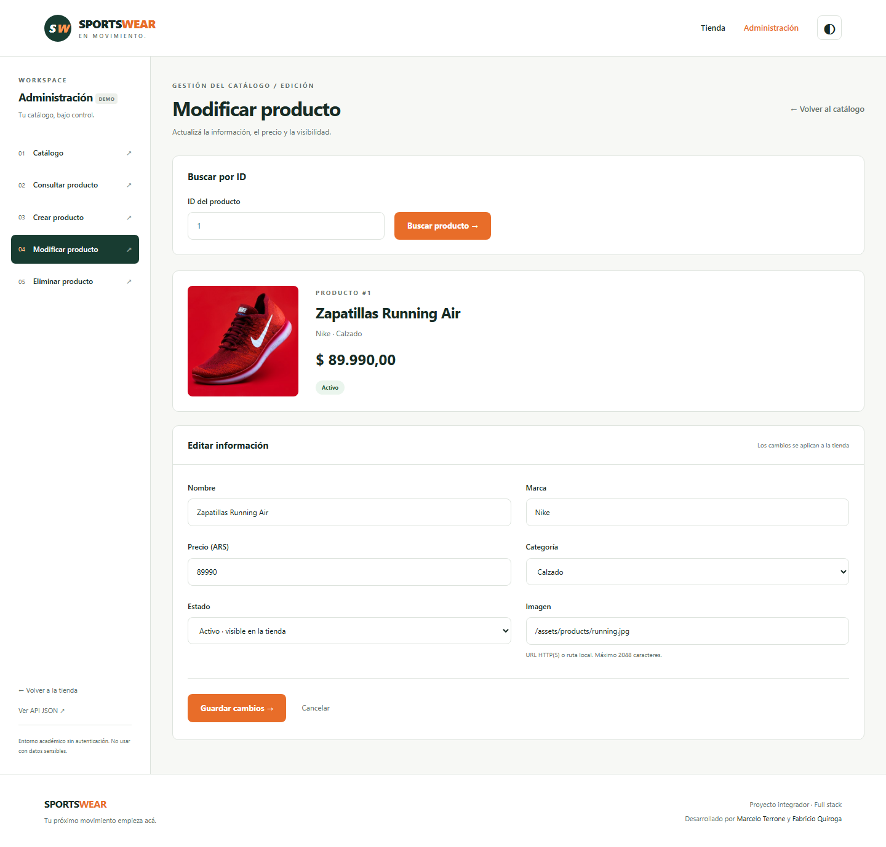

</details>

<details>
<summary><strong>09 · Eliminación con advertencia y confirmación</strong></summary>

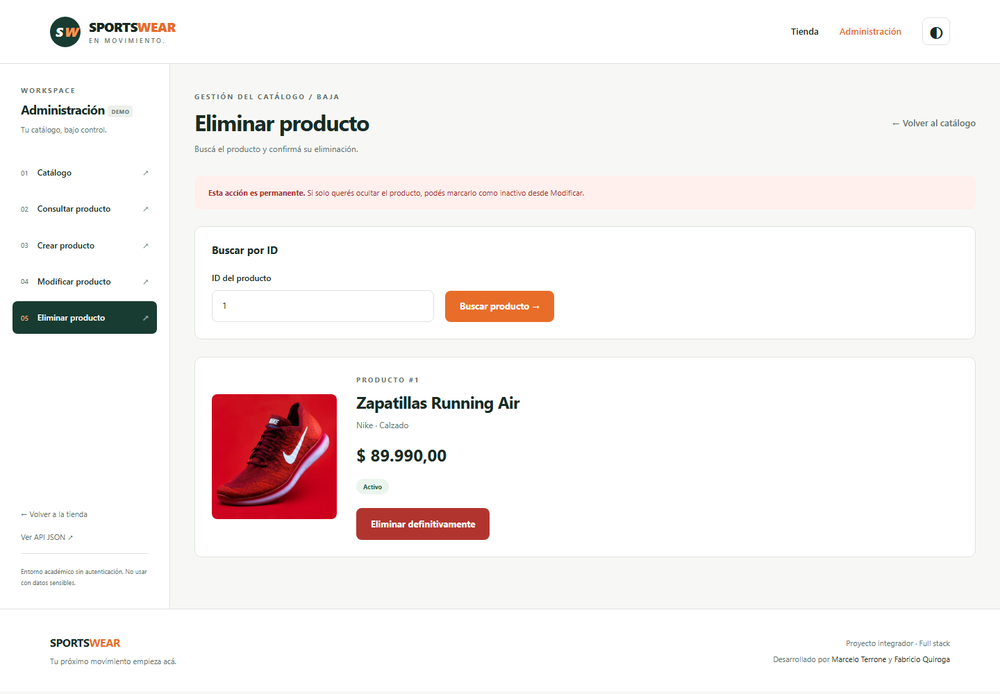

</details>

<details>
<summary><strong>10 · Tienda y carrito en móvil</strong></summary>

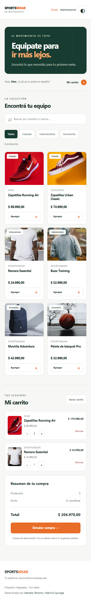

</details>

<details>
<summary><strong>11 · Administración en móvil</strong></summary>

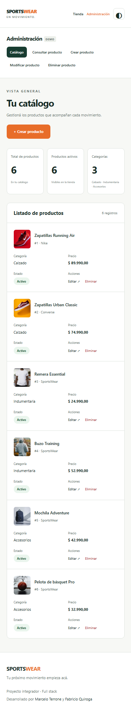

</details>

## Tecnologías y arquitectura

| Capa | Tecnologías |
| --- | --- |
| Interfaz | HTML, CSS responsive, JavaScript nativo y módulos ES |
| Vistas | EJS y parciales reutilizables |
| Servidor | Node.js 22+, Express 5 |
| Persistencia | MySQL 8+, pool de conexiones con `mysql2/promise` |
| Configuración | Variables de entorno con `dotenv` |
| Calidad | Playwright, pruebas HTTP y de navegador, GitHub Actions |

```text
Navegador
   ├── / y /tienda ── EJS + JavaScript ── /api/productos
   └── /dashboard ─── EJS + formularios ──┘
                                             │
                                     Rutas y validaciones
                                             │
                                        Controladores
                                             │
                                      Modelos → MySQL
```

Frontend y backend comparten origen: no requieren Live Server, otro proceso de frontend ni URLs de API fijas a un puerto de desarrollo.

## Instalación

### Requisitos

- **Node.js 22 o superior** y npm.
- **MySQL 8 o superior**, iniciado y accesible.
- Un usuario MySQL con permisos sobre la base elegida. `db:setup` necesita poder crear la base y la tabla si todavía no existen.

### 1. Clonar e instalar

```bash
git clone https://github.com/fasfis544/tp-integrador-backend.git
cd tp-integrador-backend
npm ci
```

### 2. Configurar el entorno

Copiá `.env.example` como `.env` y completá tus credenciales:

```bash
# Linux / macOS
cp .env.example .env
```

```powershell
# Windows PowerShell
Copy-Item .env.example .env
```

```dotenv
PORT=3000
DB_HOST=127.0.0.1
DB_PORT=3306
DB_NAME=sportswear
DB_USER=root
DB_PASSWORD=tu_password
```

Usá el puerto real de tu instancia; por ejemplo, `3307` si MySQL escucha allí. No publiques el archivo `.env`.

### 3. Preparar MySQL y ejecutar

```bash
npm run db:setup
npm start
```

`db:setup` crea la base y la tabla si no existen y carga seis productos **solo si la tabla está vacía**. No elimina ni reemplaza registros existentes. El esquema y los datos están en [`database/`](database/).

| Pantalla / servicio | URL local |
| --- | --- |
| Inicio | http://localhost:3000/ |
| Tienda | http://localhost:3000/tienda |
| Administración | http://localhost:3000/dashboard |
| API de productos activos | http://localhost:3000/api/productos |
| Estado del servidor y MySQL | http://localhost:3000/health |

Para desarrollar con reinicio automático: `npm run dev`. No hace falta ejecutar el frontend por separado.

## API REST

Base: `/api/productos`. Las solicitudes `POST` y `PUT` utilizan `Content-Type: application/json`.

| Método | Ruta | Resultado |
| --- | --- | --- |
| `GET` | `/api/productos` | Lista de productos activos |
| `GET` | `/api/productos/:id` | Producto por ID, incluso si está inactivo |
| `POST` | `/api/productos` | Crea un producto y devuelve `productoId` |
| `PUT` | `/api/productos` | Modifica el producto indicado por `id` en el cuerpo |
| `DELETE` | `/api/productos/:id` | Elimina definitivamente un producto |
| `GET` | `/health` | `200` con MySQL disponible; `503` si no conecta |

Ejemplo de cuerpo para crear un producto:

```json
{
  "nombre": "Remera Performance",
  "marca": "SportsWear",
  "precio": 29990.50,
  "categoria": "Indumentaria",
  "activo": 1,
  "imagen": "/assets/products/remera.jpg"
}
```

Para modificar, se envían los mismos campos más `"id": 1`. La respuesta de consulta mantiene el contrato original: `{ "payload": [...] }`.

**Validaciones:** ID entero positivo, precio mayor que cero con hasta dos decimales, categoría permitida (`Calzado`, `Indumentaria`, `Accesorios`), estado `0`/`1` e imagen con URL HTTP(S) o ruta local. Se devuelven códigos `400`, `404`, `413` y `500` según el caso.

## Pruebas automatizadas

```bash
npx playwright install chromium
npm test
```

La suite crea una base temporal `sportswear_test_<id>`, carga sus propios datos, inicia la aplicación en el puerto **3100** y elimina esa base al finalizar. **No ejecuta el CRUD sobre tu catálogo de desarrollo.** El usuario MySQL de pruebas requiere permisos `CREATE` y `DROP DATABASE`; usá una instancia de desarrollo, nunca producción.

**Última verificación local:** 46 pruebas aprobadas con Node.js 24, MySQL 9.7 y Chromium. [Detalle y alcance de la verificación](docs/VERIFICACION.md).

- API: CRUD real, productos inactivos, validaciones, IDs inválidos y registros inexistentes.
- Robustez: JSON malformado, límite de tamaño, base inaccesible y consultas SQL parametrizadas.
- Tienda: acceso por nombre, filtros combinados, estados vacíos, reintento e imágenes.
- Carrito: cantidades, totales, restauración, datos locales corruptos, límites y compra simulada.
- Navegador: modo oscuro persistente, almacenamiento bloqueado, texto HTML seguro y recorridos móviles.
- Administración: alta, consulta, modificación, baja, cancelación y errores visibles.

```bash
npm run test:report   # Reporte HTML de la última ejecución
npm audit            # Auditoría de dependencias
```

El workflow de [GitHub Actions](.github/workflows/tests.yml) está preparado para ejecutar la suite con Node.js 24 y MySQL 8.4 al hacer push o abrir un pull request. El resultado remoto se obtiene cuando se publique el proyecto; no se presupone un CI aprobado.

### Regenerar las capturas

```bash
npm run screenshots
```

Genera las 11 imágenes de [`docs/capturas/`](docs/capturas/) con datos aislados, a 1440 px en escritorio y 390 px en móvil. El proceso recorre las pantallas reales, espera las imágenes y usa `fullPage: true`. No altera los productos de tu base habitual.

## Estructura del proyecto

```text
├── .github/workflows/     # Pruebas en GitHub Actions
├── database/             # Esquema y productos de demostración
├── docs/                 # Capturas completas y verificación
├── scripts/              # Preparación de base y servidor de pruebas
├── src/
│   ├── app.js            # Configuración Express, vistas y errores
│   ├── api/
│   │   ├── config/       # Variables de entorno
│   │   ├── controllers/  # Controladores de productos y vistas
│   │   ├── database/     # Pool MySQL
│   │   ├── middlewares/  # Validación de solicitudes
│   │   ├── models/       # Consultas parametrizadas
│   │   └── routes/       # Rutas de API y dashboard
│   ├── public/           # CSS, JavaScript, logo e imágenes locales
│   └── views/            # Inicio, tienda y administración EJS
├── tests/                # Pruebas HTTP, navegador y capturas
├── .env.example          # Configuración sin secretos
├── index.js              # Inicio del servidor
└── playwright.config.js  # Entorno aislado de pruebas
```

`front_provisorio/` conserva las páginas de pruebas del backend original como referencia histórica; no forma parte de la aplicación servida.

## Decisiones y mejoras de integración

- Integración del frontend original en el servidor Express, conservando el logo, los autores y los flujos de tienda y administración.
- Rutas de API relativas para que el frontend no dependa de `localhost:3000`.
- Restauración del carrito dentro del flujo de carga del catálogo, evitando referencias a funciones fuera de alcance y precios locales manipulados.
- Formularios compartidos, edición precargada y mensajes de estado, en lugar de fallos silenciosos.
- Imágenes de demo locales y recurso de reemplazo si una imagen no carga.
- Puerto MySQL configurable y errores de base de datos que responden sin dejar solicitudes colgadas.
- Pruebas y capturas reproducibles sobre MySQL real, separadas de los datos del usuario.

## Seguridad y alcance

- `.env` se conserva localmente y está excluido de Git; `.env.example` no contiene credenciales reales.
- **El repositorio original tenía `.env` versionado.** Excluirlo ahora no borra el historial anterior: cualquier credencial previamente publicada debe rotarse antes de compartir el repositorio.
- El panel **no implementa autenticación ni roles**. Ocultar el enlace de administración no protege la API.
- La compra no cobra, no persiste pedidos y no descuenta stock. No hay gestión de envíos ni inventario.
- Próximos pasos posibles: autenticación y autorización, pruebas en otros navegadores, pedidos persistentes, stock y paginación.

## Autores

- **Fabricio Quiroga** — [@fasfis544](https://github.com/fasfis544)
- **Marcelo Terrone** — [@marceterrone10](https://github.com/marceterrone10)

Frontend de origen: [`marceterrone10/tp-integrador-frontend`](https://github.com/marceterrone10/tp-integrador-frontend), integrado a partir del ZIP proporcionado. El logo pertenece al proyecto original. Fotografías de demostración: [Unsplash](https://unsplash.com); [créditos y fuentes](docs/RECURSOS.md). Marcas, precios y productos se utilizan con fines ilustrativos y académicos.
